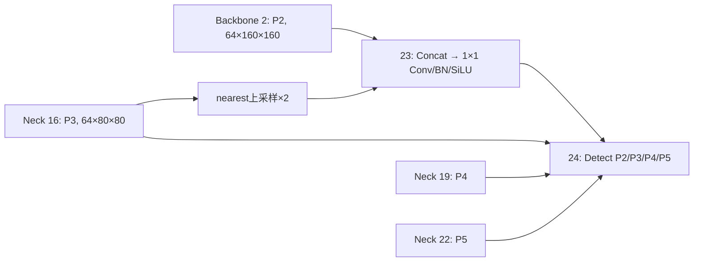

# P2/P3 最小融合诊断：从已经完成的结果出发

2026-10-12 当前状态：所有训练已停止，F1中断于58轮，其余F组完成。C0/C1/C2推理实验已完成，[报告](../../runs/crop_study/c0_c1_c2_20261012/REPORT.md)；S0–S4的640整图+最多1/2 ROI也已完成推理、评分和验证，[结果](../../runs/crop_study/s0_s4_640_20261012/REPORT.md)，[代码与复现](BUDGET_CROP_STUDY.md)。S1/S2相对640基准提高2.80/3.29pp，但仍未在精度及平均时延上优于960整图。本阶段未训练ROI网络。以下启动/恢复说明保留为历史。

历史执行（2026-10-11）：用户已要求改为batch8续训。F0从已保存22轮的检查点恢复，仍训练到100轮；后续五组从头使用batch8，基准为已有完整batch8 M0。目录沿用 `runs/fusion/formal_100e_b16_s42/`；F0混合batch历史不会作为正式公平对照，见 [执行计划](FUSION_TRAINING_PLAN.md)。下文batch16和停止状态保留为过程记录。

执行更新：2026-10-11。用户已授权batch=16正式训练，启动F0 → F2_GLOBAL → F2 → F3_PLAIN → F3 → F1，每组100轮、640、workers4、seed42，目录 `runs/fusion/formal_100e_b16_s42/`。F0作为新batch基准；以下停止状态和待授权说明保留为此前研究审计记录，当前执行见 [FUSION_TRAINING_PLAN.md](FUSION_TRAINING_PLAN.md)。
本轮已完成同一 M0 权重的640/960/1280分辨率验证及误差来源诊断，见 [RESOLUTION_STUDY.md](RESOLUTION_STUDY.md)；正式融合训练顺序与预算见 [FUSION_TRAINING_PLAN.md](FUSION_TRAINING_PLAN.md)，等待用户明确授权。以下保留原融合审计及设计记录。
M0–M3 各完成100轮，M4中断于已完成18轮，M5未开始。全部结果、日志和权重保留。
本文件取代继续扩展 M1–M3 的研究路线；历史需求与代码保留供审计。

## 1. 已经证明什么、尚未证明什么

数据源为 `runs/candidates/formal_100e_b8_s42_v2/*/evaluation/evaluation.json`，
均是 seed42、100轮最佳权重在548张val图像上的独立验证，不用最后一轮CSV替代最佳权重结果。
配置审计已比较预训练文件SHA256、图像列表、标注文件内容、完整有效训练参数、0–22层和Detect连接，M0–M3均一致。
候选辅助监督属于各自待检验机制，不是额外共享训练设置。

|模型|mAP50|mAP50:95|Δ mAP50:95 pp|AP-small*|AR-small*|密集小目标Recall†|稀疏小目标Recall†|
|---|---:|---:|---:|---:|---:|---:|---:|
|M0 P2基准|35.19|20.37|0|10.72|20.60|33.92|39.25|
|M1 方向净空|35.21|20.29|−0.082|10.37|19.88|34.16|38.74|
|M2 环域路由|35.35|20.48|+0.113|10.82|20.83|33.88|40.67|
|M3 边界恢复|35.22|20.41|+0.040|10.47|20.35|34.40|39.40|

单位：指标为%，差值为百分点。* 补充COCO协议，原图面积≤32²、maxDet500；
† 固定conf0.25、IoU0.5、同类一对一匹配、原图小目标、归一化间距阈值2。
Ultralytics mAP、补充COCO AP和分组Recall口径不同，不能混算。

结论：M1没有整体收益；M2只有很小的总体收益，密集组没有提升；M3整体略有提升，AP-small反而下降。
这些数据不支持继续调参、叠加或宣布几何监督有效。
失败原因目前只能列为待检验解释：教师可能不等于最佳上下文选择、辅助任务可能与检测任务不一致、
弱残差贡献可能被基准融合覆盖；当前没有aux=0/随机教师/多种子结果区分这些解释。

旧 E0 三种子平均18.95%与M0的20.37%有1.42pp差异，但旧E0实测配置为batch16/workers8，
M0为batch8/workers4，并且M0仅seed42；不能把全部差异归因于P2。
尤其batch会改变优化步数和AdamW状态，即使nbs相同也不能自动视为公平配对。

审计脚本：`python code\test\analyze_fusion_results.py`。
详细结果：`runs/candidates/formal_100e_b8_s42_v2/review/fusion_audit/analysis.md` 与 `.json`。

## 2. 实际架构

原始YAML：`ultralytics/cfg/models/11/yolo11.yaml`；P2基准：`code/test/configs/generated/yolo11n-m0.yaml`。
原始YOLO11n Detect在23层，读取16/19/22；P2基准在23层插入融合，Detect移至24层。
Backbone 0–10、原Neck 11–22保持原定义。

|位置|来源|实际通道数|640方形输入的H×W|步长|用途|
|---|---|---:|---|---:|---|
|2|Backbone C3k2|64|160×160|4|浅层P2输入|
|16|Neck C3k2|64|80×80|8|P3语义输入、P3检测|
|19|Neck C3k2|128|40×40|16|P4检测|
|22|Neck C3k2|256|20×20|32|P5检测|
|23|新增融合 [2,16]|64|160×160|4|P2检测|
|24|Detect [23,16,19,22]|64/64/128/256|上述四尺度|4/8/16/32|10类别检测|

实测形状来自 `runs/fusion/profile.json`。单图推理可采用矩形letterbox，实际H可能小于640对应的高度。



**关键更正：M0的23层不是Concat+C3k2，而是NSCRFusion(mode=none)内的Concat+1×1 Conv。**
记 D=P2、S=P3、U=nearest、Φ=现有128→64的Conv/BN/SiLU，则基准为：

`Y0 = Φ(Concat(D, U(S)))`

它能学习通道融合，但卷积核在空间位置共享。不能因为没有显式门控就断言它不会融合语义；
真正待验证的是，增加位置相关的尺度选择是否比现有通道混合更好。
第16层已通过原Neck融合更深层语义，第一阶段无需另接P4或重构整个Neck。

## 3. M0漏检与特征诊断

548张val图像的保存预测、已转换正标注、固定conf0.25和IoU0.5：

|原图等效尺寸sqrt(wh)|目标数|Recall|
|---|---:|---:|
|<8像素|2303|5.47%|
|8–16像素|9536|23.92%|
|16–32像素|14580|45.65%|
|≥32像素|12168|73.59%|

缩放到640输入后，<8像素目标11818个，Recall18.38%；<8与8–16尺寸合计26925/38587=69.78%。
全目标Recall随conf0.25/0.10/0.05分别为46.69%/58.84%/64.03%，提示置信度不足也参与漏检，
不能只归因于边界或空间几何。降低阈值不是AP提升，更不能修改评估阈值制造模块收益。
未匹配GT中有2752个存在其他类别预测的IoU≥0.5重叠，占全部漏检约13.38%；
这个统计可能包含密集邻居重叠，仅为混淆线索，不是因果分类。
补充COCO每类AP显示自行车AP50:95=3.45%、遮阳三轮车5.98%，汽车52.71%。
因此类别难度差异也必须进入误差分析。

64张按seed42哈希固定选择的验证图像、同一冻结M0模型的推理诊断：

|推理操作|原图small Recall|
|---|---:|
|完整M0|33.19%|
|屏蔽P2检测输出|15.08%|
|置零融合中的P2输入|15.68%|
|置零融合中的P3输入|15.18%|

两种输入都对现有模型重要。置零引入分布变化、NMS竞争变化，不能当作重训练消融，不能证明改善融合必然提高AP。
小目标与干净背景的通道RMS比：层2=1.127，层16=1.170，层23=1.038。
层23能量区分较弱是一个待验证线索；激活幅度不等于语义可分性，不能仅凭能量或热力图定性。
特征统计使用落在框内的网格中心，排除padding、全部目标与忽略框后统计背景；极小框可能没有对应中心。
数据与固定样本名单在 `runs/fusion/diagnosis_m0/diagnosis.json`。

复现：`python code\test\diagnose_fusion.py --limit 64`；`--limit 0`检查整个验证集。

## 4. 仅改变23层的三条成熟路线

实现：`ultralytics/nn/modules/p2_fusion.py`；架构：`code/test/fusion_experiments.py`。
全部保留Φ、0–22层与24层连接。无需GT辅助监督，不改检测损失、标签分配器、类别或检测头。
为了与M0完全同一损失记录格式，仍保留原nscr元数据的none监督与零辅助项。

### F1：P3语义校准浅层输入

`g = sigmoid(Conv1×1(S))`

`D' = D × (1 + 0.1 × (2U(g)−1))`

`Y = Φ(Concat(D', U(S)))`

门控在P3分辨率计算，仅输出一个空间通道；P2残差乘子范围0.9–1.1。
这是保守的常规语义门控实例；若失败，只说明此具体强度与结构未起效，不能否定所有语义引导方法。

### F2：动态分配两个尺度的贡献

`[a,b] = softmax(Conv1×1(S), channel)`

`Y = Φ(Concat(2U(a)×D, 2b×U(S)))`

实现中先给S乘b再上采样，nearest下与公式等价。
在已有Φ的两个输入权重块之前加权，仍通过Φ对齐到统一输出通道，不额外添加两路投影或全通道高分辨率卷积。
**F2_GLOBAL**使用两个可学习全局logits代替空间logits；与F2共同检验“位置变化”的额外收益。
固定a=b=0.5时恰好等于F0，因此F0也是无额外复杂模块的固定权重对照。
全局加权可被原投影权重吸收，主要是优化参数化对照，不能将它解释为新增表达能力。
训练日志`fusion_weights.csv`记录每轮最后一个训练batch的权重均值/标准差/<0.05/>0.95比例，
用于发现塌缩；不是整个验证集统计，不能把门控大小直接解释为真实前景概率。

### F3：语义门控的细节残差

`H = D − AvgPool3×3(D)`

`R = DWConv3×3(H)`

`g = sigmoid(Conv1×1(S))`

`D' = D + 0.1 × 2U(g) × R`

`Y = Φ(Concat(D', U(S)))`

**F3_PLAIN**令2g=1，保留相同DW分支与残差，排除增加卷积/细节分支带来的收益。
F3不与F1/F2堆叠；其原始D路径始终保留。高通本身同时包含目标细节与背景纹理，门控是否有效必须实验回答。

### 初始化与成本

门控logits为零、F3的DW滤波器为零，所有候选起始函数与F0相同。
额外模块构造使用`fork_rng`，不消耗共享结构的随机序列；已逐张量验证共享权重与Detect初始化相同。
局部COCO预训练策略与M0一致：0–22层兼容权重迁移，旧P3/P4/P5头移到24层分支1/2/3，
P2头新初始化，不迁移COCO80类别输出至VisDrone10类别。每个模型都迁移448个兼容张量。

RTX3090，FP32、batch1、640方形零输入，融合后纯forward，10次预热/30次交错测量：

|模型|新增参数|总GFLOPs|前向均值ms|
|---|---:|---:|---:|
|F0|0|11.45820|8.52|
|F1|65|11.45902|8.68|
|F2_GLOBAL|2|11.45820|8.60|
|F2|130|11.45984|8.64|
|F3_PLAIN|576|11.48769|8.52|
|F3|641|11.48851|8.61|

THOP GFLOPs主要统计可识别卷积算子，不完整计入pooling、softmax和逐元素运算；
实测延迟有计时噪声，因此不能把F3_PLAIN与F0的极小差异视为速度提升。
这些是新结构加载相同预训练后的成本测试，不是训练后的性能结果。
与历史8.10ms的训练后M0使用不同测量时段，成本表以本次F0的8.52ms配对比较。

## 5. 公平训练与当前执行状态

结构、损失梯度、预训练映射、RGB推理、保存加载、640尺寸前向已验证。
F1–F3及简单对照**尚未进行正式100轮训练，也没有实际AP收益结论**。
根据最新停止指令没有自动重启、创建后继训练任务或开启训练队列。

正式配置沿用M0：100epochs、batch8、workers4、imgsz640、seed42、AdamW、lr0=.001、
lrf=.01、cos_lr、nbs64、weight_decay=.0005、warmup3、AMP、mosaic1、末10轮关闭mosaic，
mixup/cutmix/copy_paste均0、maxDet500、patience101、每10轮检查点。
输入图像列表及标注转换保持历史一致。正式队列启动前检查M0预算、预训练内容、数据清单和标注内容SHA256。
实验文件含实现SHA256与有效训练参数。记录相同种子，但CUDA某些算子不保证逐位一致。

用户以后明确决定启动时，在已激活yolo的CMD终端运行：

```bat
python -u code\test\run_fusion.py --project runs\fusion\formal_100e_b8_s42 --experiments F1 F2_GLOBAL F2 F3_PLAIN F3 --epochs 100 --batch 8 --workers 4 --imgsz 640 --device 0 --seeds 42
```

这是三个机制与两个简单对照，不是五个独立创新模块；F0直接复用已完成M0_seed42。
仅查看计划不会训练：

```bat
python code\test\run_fusion.py --dry-run
python code\test\status_candidates.py --project runs\fusion\formal_100e_b8_s42
python code\test\stop_candidates.py --project runs\fusion\formal_100e_b8_s42
```

支持显式中断恢复单模型：

```bat
python -u code\test\train_fusion.py --experiment F1 --project runs\fusion\formal_100e_b8_s42 --resume runs\fusion\formal_100e_b8_s42\F1_seed42\weights\last.pt
```

不自动覆盖旧目录、降batch或缩epochs。队列首个失败即停止，状态和日志保留。
正式结果全部完成后才排名；若某机制相对M0达到约0.5pp且small指标合理、未明显增加延迟，
再加入同种子基准重复42/43/44，报告均值、样本标准差与配对差值。
0.5pp仅是预先记录的经验性算力筛选条件，不是统计显著性。
若没有机制通过，应转向实际漏检、预处理和分辨率，而不是叠加更多模块。

## 6. 评价协议审计与限制

历史转换器将score≤0、category0/11视为忽略框，且按框中心是否在忽略框内删除正标注；
YOLO背景分类损失仍覆盖忽略区域。这个训练策略与官方评价前处理不同。
为了只改变融合，第一轮不暗中改转换器或训练集；如修正训练忽略策略，需作为单独数据变量重训基准。

官方`dropObjectsInIgr`用**category0的并集像素图**删除重叠占框面积≥50%的框；
`evalRes`对score0 GT作ignore匹配；`calcAccuracy`先限制每图全类总检测数，再按类别计算；
`VOCap`使用连续precision envelope积分，AP-small不是此工具定义的指标。
现有Ultralytics mAP未走这个官方流程；补充COCO crowd也只是近似，不能贴上“官方VisDrone AP”的标签。

新脚本`visdrone_protocol.py`从原始标注及已导出的预测复现这些规则，单独保存
`evaluation/visdrone_reference_python.json`，不覆盖历史指标。已测试忽略区域并集、
正样本优先匹配、忽略多匹配、重复检测、空GT与AP积分；**尚未与MATLAB实跑逐项对齐**。
公开`calcAccuracy`在每个出现该类别的图像上追加evalClass，导致重复类别索引加权；
其GT分母也包括忽略GT。本脚本逐字保留这些约定，并额外提供去重类别的macro结果，不混淆二者。
论文正式结果必须在原工具或经原工具对齐的实现上确认；附带MATLAB桥接文件已经存在。

本次已完成对M0–M3全部548图预测的Python参考重评分：

|模型|参考AP50|参考AP50:95|相对M0 pp|去重类别macro AP50:95|
|---|---:|---:|---:|---:|
|M0|34.891|19.202|0|18.261|
|M1|34.980|19.256|+0.054|18.158|
|M2|35.034|19.290|+0.088|18.460|
|M3|34.648|19.164|−0.039|18.112|

这组数值仍不是MATLAB原工具实跑；它提示弱增益的方向随评价口径可能变化，
尤其M1/M3不能仅依据历史Ultralytics表宣布胜负。各口径一致地没有给出足够大的稳定机制收益。

```bat
python code\test\visdrone_protocol.py --project runs\candidates\formal_100e_b8_s42_v2
```

参考源码：[VisDrone工具](https://github.com/VisDrone/VisDrone2018-DET-toolkit/tree/master/utils)。

## 7. 文献核对与研究决策

- [CF-YOLO原文](https://www.nature.com/articles/s41598-025-99634-0)：已包含CS-FPN、FRM、Sandwich权重融合，不能将语义门控换名为原创。
  [表1](https://www.nature.com/articles/s41598-025-99634-0/tables/1)报告CS重构GFLOPs从6.6到17.8，最终23.9；代价必须一起比较。
  其参数栏25.8等数值与标准YOLO11n参数规模明显不一致，本文不擅自修正成2.58或作为可靠参数量复现依据。
  [表2](https://www.nature.com/articles/s41598-025-99634-0/tables/2)中单加Sandwich的mAP50:95从24.3降到23.7，说明成熟融合也不保证单独有效。
- [MSEF-YOLO11s](https://link.springer.com/article/10.1007/s11227-025-08186-7)：采用LPMS、MS-BSA、LSDDH及P2，基于s规模且不使用预训练。
  原文分开报告MS-BSA与P2；不能把整个网络收益迁移到当前n规模、预训练、单层修改的设置。
- [DFAS-YOLO](https://www.mdpi.com/2072-4292/17/20/3476)：SAAF/GDLA同时伴随P2增加、P5移除和回归损失变化，不能直接归因于一处融合。
- [SR-YOLO，2025 RGB航拍版本](https://www.mdpi.com/2072-4292/17/14/2441)：基于YOLOv8s，同时修改SR-Conv、P2/双向融合和NWD损失。
  SR-YOLO名称存在不同论文，本文明确引用该版本，不拼接不同同名模型结论。

上述结果只能指导对照选择，不能作为F1–F3性能保证；输入协议、网络规模及训练策略不同，不在我们的结果表里直接排名。
当前没有独特机制被证明，故不提供“已成立原创模块X”。
如果F2相对global或F3相对plain有重复收益，再围绕真正起效的**位置相关语义选择**或**细节保护**研究，
并与FRM、MS-BSA等近邻方法设置同预算对照；届时再决定是否有实质新机制。

## 8. EI论文的证据顺序

当前可以写结构与诊断、成熟融合机制筛选、统一训练与评价协议；不能写虚构的最终改进结果。
若机制通过筛选，后续至少有M0、普通轻量融合、已有成熟融合、去核心机制、完整X、关键分支消融，
42/43/44配对重复与第二数据集验证。论文贡献必须来自独立机制收益和误差分析，
而非P2与几个现成算子组合。若筛选失败，应如实记录失败和新的漏检诊断结论。
